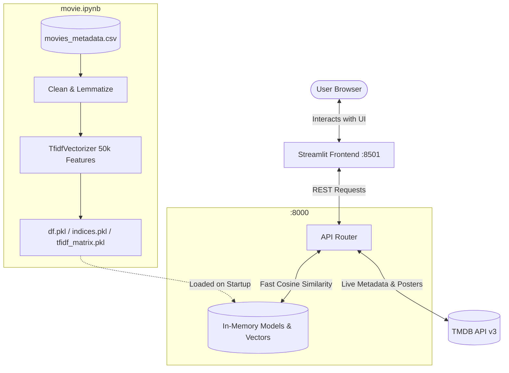

# 🎬 CineMatch: AI-Powered Movie Recommendation System

[](https://www.python.org/)
[](https://fastapi.tiangolo.com/)
[](https://streamlit.io/)
[](https://scikit-learn.org/)
[](https://www.themoviedb.org/documentation/api)

A hybrid, production-ready movie recommendation platform combining **Content-Based Natural Language Processing (TF-IDF Cosine Similarity)** trained on 45,000+ movies with **Real-Time Live Discovery** powered by **The Movie Database (TMDB) API**.

Built with a high-performance **FastAPI** backend and an interactive, glassmorphic **Streamlit** web frontend.

---

## 🌟 Key Features

- **Dual Recommendation Engine**:
  - **Content-Based NLP (TF-IDF)**: Computes high-dimensional cosine similarity across movie overviews, taglines, genres, and keywords from a preprocessed dataset of over 45,000 films.
  - **Dynamic Genre Discovery**: Live recommendations using TMDB's discovery service for real-time similarity and genre matching.
  - **Graceful Fallbacks**: Automatically falls back to genre-based recommendations if a selected title is not in the offline dataset (e.g. brand-new releases).
- **Modern, Responsive Frontend (Streamlit)**:
  - **Live Autocomplete Search**: Instant suggestions with release years as you type keywords.
  - **Curated Home Feeds**: Browse by *Trending*, *Popular*, *Top Rated*, *Now Playing*, and *Upcoming*.
  - **Adjustable Poster Grid**: Dynamic slider allowing users to adjust poster density from 4 to 8 columns per row.
  - **Deep-Dive Details Page**: High-resolution movie posters, backdrop banners, release date, genres, synopsis, and dual recommendation rails.
  - **URL Routing & State Persistence**: Bookmarkable and refresh-safe URLs (`?view=details&id=...`).
- **Robust Asynchronous Backend (FastAPI)**:
  - High-concurrency async endpoints with HTTP client pooling (`httpx`).
  - Fast in-memory sparse matrix computations using `scipy.sparse`.
  - Built-in interactive Swagger documentation and health checks.

---

## 🏗️ System Architecture



---

## 📁 Repository Structure

```text
Movie_Recomendation/
├── .venv/                                # Python virtual environment
├── README.md                             # Project documentation
└── Movie_Recommendation_System/
    ├── app.py                            # Streamlit frontend application
    ├── main.py                           # FastAPI backend server
    ├── requirements.txt                  # Python dependencies
    ├── .env                              # API keys and secrets (TMDB_API_KEY)
    ├── .gitignore                        # Git ignore file
    ├── movie.ipynb                       # Data preprocessing & TF-IDF training notebook
    ├── movies_metadata.csv               # Raw movie dataset (45k+ records)
    ├── df.pkl                            # Preprocessed movie DataFrame pickle
    ├── indices.pkl                       # Title-to-index mapping dictionary pickle
    ├── tfidf.pkl                         # Trained TfidfVectorizer pickle
    └── tfidf_matrix.pkl                  # Compressed Sparse Row (CSR) TF-IDF matrix
```

---

## 🚀 Getting Started

### 1. Prerequisites
- **Python**: Version `3.10` or higher (tested on Python `3.13`)
- **TMDB API Key**: Obtain a free API key from [The Movie Database (TMDB)](https://www.themoviedb.org/settings/api).

---

### 2. Installation & Setup

1. **Clone the repository**:
   ```bash
   git clone https://github.com/your-username/Movie_Recomendation.git
   cd Movie_Recomendation/Movie_Recommendation_System
   ```

2. **Create and activate a virtual environment**:
   - **Windows (PowerShell)**:
     ```powershell
     python -m venv ..\.venv
     ..\.venv\Scripts\Activate.ps1
     ```
   - **Linux / macOS**:
     ```bash
     python3 -m venv ../.venv
     source ../.venv/bin/activate
     ```

3. **Install dependencies**:
   ```bash
   pip install -r requirements.txt
   ```

4. **Configure Environment Variables**:
   Create a `.env` file inside `Movie_Recommendation_System/`:
   ```ini
   TMDB_API_KEY=your_tmdb_api_key_here
   API_BASE=http://127.0.0.1:8000
   ```

---

### 3. Running the Application

Running the system requires **two terminal windows**:

#### Terminal 1 — Start the FastAPI Backend:
```powershell
# Navigate to the inner system folder
cd Movie_Recommendation_System

# Start the uvicorn server
uvicorn main:app --reload --port 8000
```
> The API will be available at **`http://127.0.0.1:8000`**  
> Interactive Swagger docs at **`http://127.0.0.1:8000/docs`**

#### Terminal 2 — Start the Streamlit Frontend:
```powershell
# Navigate to the inner system folder
cd Movie_Recommendation_System

# Start Streamlit
streamlit run app.py
```
> The web interface will automatically open in your browser at **`http://localhost:8501`**

---

## 🔌 API Endpoints Reference

| Method | Endpoint | Description |
| :--- | :--- | :--- |
| `GET` | `/health` | Healthcheck endpoint (`{"status": "ok"}`). |
| `GET` | `/home` | Returns movies for home feed (`popular`, `trending`, `top_rated`, `now_playing`, `upcoming`). |
| `GET` | `/tmdb/search` | Live multi-result movie search from TMDB with title matching. |
| `GET` | `/movie/id/{movie_id}` | Detailed metadata for a specific TMDB movie ID (poster, backdrop, overview, genres). |
| `GET` | `/movie/search` | Recommendation bundle returning both TF-IDF content recommendations and genre discover matches. |
| `GET` | `/recommend/genre` | Genre-based recommendation fallback based on a TMDB ID. |

---

## 🧠 Machine Learning & Data Pipeline

The machine learning pipeline is documented in [`movie.ipynb`](movie.ipynb):

1. **Data Cleaning**: Handled missing values, removed duplicate titles, and parsed JSON string columns (genres, keywords, production info).
2. **Feature Engineering**: Built a composite `tags` column combining movie overviews, genre labels, and metadata.
3. **NLP Preprocessing**: Tokenization, lowercase transformation, stop words elimination, and WordNet lemmatization.
4. **Vectorization**:
   - `TfidfVectorizer(max_features=50000, ngram_range=(1, 2), stop_words='english')`
   - Fitted on 45,447 movie descriptions to generate a high-dimensional Compressed Sparse Row (CSR) matrix.
5. **Cosine Similarity**: Fast vectorized cosine similarity scores computed via linear kernel matrix multiplication `(tfidf_matrix @ query_vector.T)`.

---

## 🛠️ Tech Stack

- **Backend**: FastAPI, Uvicorn, Pydantic, HTTPX, Python-dotenv
- **Frontend**: Streamlit, Custom Glassmorphic CSS
- **Machine Learning & Data**: Scikit-Learn, Pandas, NumPy, SciPy
- **External Data Source**: The Movie Database (TMDB) REST API v3

---

## 📄 License

This project is open-source and available under the [MIT License](LICENSE).
